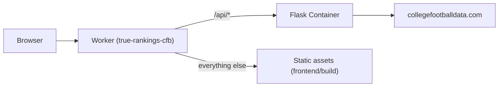

# Deploy to Cloudflare Workers

**Goal:** One Worker deploy for the whole app — static SvelteKit frontend + Flask API container. Production secrets live **in Cloudflare**, not GitHub or Cursor.

See also: [SECRETS.md](./SECRETS.md)

---

## Architecture



| Path | Handled by |
|------|------------|
| `/api/*` | Worker → Cloudflare Container (Flask) |
| `/`, `/methodology`, etc. | Static assets (SPA fallback to `index.html`) |
| `/rankings/2024/*.json` | Static precomputed rankings |

One `wrangler deploy` uploads **both** the frontend build and the API container image.

---

## Environments (dev + prod)

**You only need one production Worker to start.** Dev is optional.

| | Production (required) | Dev (optional) |
|---|------------------------|----------------|
| **When** | Live site on `main` | Staging / testing before prod |
| **Worker name** | `true-rankings-cfb` | `cfb-rankings-dev` |
| **Public URL** | Custom domain: pending Michael's choice | Custom domain: pending Michael's choice |
| **How** | Workers Builds on `main` (automatic) or `npm run deploy` | Manual `npm run deploy:dev` only if you want a second Worker |

**Workers Builds (recommended):**
- **Production branch** (`main`) → deploys `true-rankings-cfb` automatically
- **Other branches** → preview versions (`wrangler versions upload`) on the same Worker — no second Worker required

You do **not** need two Workers unless you want a permanently separate staging URL with its own secrets.

---

## Custom domain

Custom domain: pending Michael's choice. Do not name a hostname in the repo.

When a domain is chosen:

1. Attach it to Worker `true-rankings-cfb` in Cloudflare → **Domains & Routes**.
2. Set the frontend build variable `PUBLIC_SITE_URL={SITE_URL}` (absolute `http(s)` origin, no trailing slash).

Until `PUBLIC_SITE_URL` is set, the build uses same-origin relative links, omits the absolute canonical and `og:url`, and does not ship `sitemap.xml` or a robots `Sitemap:` line. `scripts/generate-public-files.mjs` writes `robots.txt`, `llms.txt`, `llms-full.txt`, and the sitemap at build time. Vite exposes `PUBLIC_*` to the client, so that prefix is not for secrets. CI checks an unset build and a build with `PUBLIC_SITE_URL=https://example.test`, and scans `frontend/build`, `worker/src`, the Python sources, and the public Markdown docs for a hard-coded public host.

---

## Secrets (dashboard — no CLI required)

`wrangler secret put` is optional. Prefer the dashboard:

1. **Workers & Pages** → `true-rankings-cfb` → **Settings** → **Variables and Secrets**
2. **Add** → type **Secret** → name `CFBD_API_KEY` → paste value → **Encrypt** → **Deploy**

Repeat for `CACHE_CLEAR_SECRET` if cache clear should be enabled, and for `SPEND_KILL_SECRET`. DevSecOps provisions on Michael's yes (D-20261019-174). Values are encrypted and never shown again. `XAI_API_KEY` is provisioned by DevSecOps on Michael's yes. Do not create or paste secret values from this repo.

For `cfb-rankings-dev` (only if you use the dev Worker): same steps on that Worker, or use `wrangler secret put CFBD_API_KEY --env dev` once.

---

## Workers Builds settings (Cloudflare dashboard)

**Settings → Build** on your Worker:

| Setting | Value |
|---------|-------|
| Production branch | `main` |
| Build command | `npm run build` |
| Deploy command | `npx wrangler deploy --env=""` |
| API token | Custom token with **Containers** edit (see below) |

Root `npm ci` runs `postinstall`, which installs `frontend/` and `worker/` deps. The `build` script also runs `npm ci --prefix frontend` before `vite build` so the build still works if `postinstall` is skipped (e.g. cached install).

Use **Node.js 22+** (`.nvmrc` in repo root). Wrangler 4.119+ requires Node 22; Node 20 will fail at deploy with `Wrangler requires at least Node.js v22.0.0`.

### Builds API token (required for Containers)

The default **Create new token** for Workers Builds only grants Workers Scripts / KV / R2 — **not Containers**. This Worker builds a Docker image and pushes it to Cloudflare’s container registry during `wrangler deploy`. Without Containers permission, deploy ends with a bare:

```text
✘ [ERROR] Unauthorized
Failed: error occurred while running deploy command
```

after the image has already built successfully (assets + Worker script may already be uploaded).

Fix:

1. **My Profile → API Tokens → Create Token** (or edit the Builds token).
2. Include at least:
   - Account → **Workers Scripts** → Edit
   - Account → **Workers Containers** / Containers → Edit (wording varies in the UI)
   - Account → **Account Settings** → Read (Builds default)
   - Zone → **Workers Routes** → Edit (if you use custom domains)
3. On the Worker → **Settings → Builds** → select that token as the Builds **API token**.
4. Set Deploy command to `npx wrangler deploy --env=""` (avoids the multi-env warning; top-level prod config).
5. Re-run the failed build (or push an empty commit).

Confirm Workers **Paid** is enabled — Containers are Paid-only.

**Runtime secrets** (for the live app): **Settings → Variables and Secrets** (not Build Variables).

| Secret | Required |
|--------|----------|
| `CFBD_API_KEY` | Yes (live rankings) |
| `XAI_API_KEY` | provisioned by DevSecOps on Michael's yes. Not a var. The Worker sends it only to the AI Gateway grok path. |
| `CACHE_CLEAR_SECRET` | Optional. Protects `POST /api/cache/clear`. The container reads header `X-Cache-Secret` only. |
| `SPEND_KILL_SECRET` | DevSecOps provisions on Michael's yes (D-20261019-174). Protects `POST /api/spend/kill`. Header `X-Spend-Kill-Secret` only. Stays on the Worker. Unset returns 403 and does not fall back to `CACHE_CLEAR_SECRET`. |

Set or clear the stored kill latch with `POST /api/spend/kill` and header `X-Spend-Kill-Secret`. The JSON body may contain only `ai_kill` and `cfbd_kill`, each `0` or `1`. `1` latches the flag. `0` clears it. DevSecOps provisions on Michael's yes (D-20261019-174). This repo does not set or read the value.

### Paid-call caps (deploy migration)

Production `AI_MODE=live` (Workers AI) and `CFBD_OFFLINE=1` in `wrangler.toml`. Preview and `env.dev` stay `AI_MODE=stub`.

| Control | Default when unset | Where it is enforced |
|---------|--------------------|----------------------|
| `XAI_MAX_CALLS` / `XAI_ENABLED` | hard **0** / off | xAI is refused even when `XAI_API_KEY` is set. The gateway path stays in the Worker and is not called. |
| `XAI_WEEKLY_USD_CAP` | **0** | Rolling ISO-week dollar stop on `spend-budget` (`xai:usd:YYYY-Www`). CI fails when this plus the CFBD paid tier reaches $5. The tier is $0.23 only if `CFBD_TIER=1`. |
| `AI_MAX_CALLS` | **100/day** | Workers AI on `spend-budget`. `@cf/meta/llama-3.1-8b-instruct-fp8`, max 80 output tokens, 4000 input characters. 100 × 58 Neurons = 5800, ceiling 8000. A higher `AI_MAX_CALLS` still stops at 100. |
| `CFBD_MAX_CALLS` | **4/day** in production `wrangler.toml` (unset code fallback 25/day) | provider `cfbd`, source `app`. Cron is 24/Sunday. 24×52/12 + 4×31 = 228, under the 700 app ceiling. 150 is reserved for MCP via #115. 50 is margin. |
| `AI_KILL` | off (`0`) | Stops xAI and Workers AI |
| `XAI_KILL` / `WORKERS_AI_KILL` | off (`0`) | Stops that provider |
| `CFBD_KILL` | off (`0`) | Worker gate and Flask |
| Visitor rate limit | 60/min on `/api/*`, 10/min on `/api/agent/*` | Workers Rate Limiting bindings, key = `CF-Connecting-IP` |
| Preview / dev versions | `AI_MODE=stub`, `CFBD_OFFLINE=1` | Worker, unless `PREVIEW_AI_MODE` / `PREVIEW_CFBD_OFFLINE` is set |
| `CF_ACCOUNT_ID` | non-secret var, empty until Release Ops sets it | Account segment of the AI Gateway URL |
| `AI_GATEWAY_ID` | `true-rankings` | Gateway id for both providers |

Both providers go through Cloudflare AI Gateway, for logging only. xAI uses `https://gateway.ai.cloudflare.com/v1/{CF_ACCOUNT_ID}/{AI_GATEWAY_ID}/grok/v1/chat/completions`. Workers AI passes `gateway: { id: AI_GATEWAY_ID }` on `env.AI.run`, with cache skipped. The `spend-budget` instance stays the source of truth for budgets.

Release Ops, once: create AI Gateway `true-rankings` in the account. Do not create it from this repo. Then set the non-secret var `CF_ACCOUNT_ID` to that account id. An empty account id refuses the live xAI call.

This change does not add a Durable Object migration. The global counters use SQLite storage on the existing `CfbApiContainer` class, instance name `spend-budget`, and that fetch returns before the container process starts. Workers Builds on pull requests upload a version (`wrangler versions upload`). A new migration tag is rejected there (`pending Durable Object migration`). The `API_RATE_LIMITER` (`namespace_id` `9301`) and `AGENT_RATE_LIMITER` (`namespace_id` `9302`) bindings are created on deploy. Dev uses `9311` and `9312` so it does not share production counters. No Cloudflare dashboard rate-limit rule is required for this change.

Flask reaches the Durable Object by calling `http://spend.budget/consume`. The container outbound handler (`CfbApiContainer.outboundByHost`, which needs `ContainerProxy` exported from the Worker) turns that into a DO request. If the gate cannot be reached, the live call is refused.

`/api/rankings`, `/api/matchup`, and `/api/weeks` serve the precomputed manifest only. Custom settings return `400` JSON. A visitor rate limit returns `429` with `{"busy": true, "message": "Busy right now. Try again later."}`. An explain cap or kill switch returns that same busy flag with the stub explanation. `/agent/explain` accepts an allowlisted `question_id` only.

---

## One-time setup (local deploy alternative)

### Prerequisites (local deploy only)

- Cloudflare account with **Workers Paid** plan (required for Containers)
- Docker running locally (for `wrangler deploy` to build the API image)
- `wrangler login` once on your machine

### Deploy locally

```bash
npm ci   # installs root, frontend, and worker via postinstall
npm run deploy          # production
npm run deploy:dev      # optional second Worker
```

First deploy builds the Docker image and can take several minutes. The Worker may not serve traffic until containers are provisioned (~2–5 min).

### Verify

```bash
WORKER_URL="{SITE_URL}"
curl -sf "${WORKER_URL}/"
curl -sf --max-time 120 "${WORKER_URL}/api/rankings?year=2024&week=10" | head -c 200
```

Open `{SITE_URL}` in a browser once the domain is chosen — rankings for 2024 should load.

### 5. Connect GitHub (optional CI deploy)

**Workers & Pages** → **Workers** → **Create** → connect this repo, or use GitHub Actions:

Repository variables:
- `ENABLE_CLOUDFLARE_DEPLOY` = `true`
- `WORKER_URL` = `{SITE_URL}` once the custom domain is chosen (for smoke tests)

Repository secrets:
- `CLOUDFLARE_API_TOKEN`
- `CLOUDFLARE_ACCOUNT_ID`

---

## Custom domain (Porkbun → Cloudflare)

Porkbun has no Cloudflare integration — DNS is manual.

### Recommended: Cloudflare DNS

1. Add your domain to Cloudflare; point Porkbun nameservers at Cloudflare
2. Worker → **Settings → Domains & Routes** → **Add** → **Custom Domain** → e.g. `rankings.yourdomain.com`
3. Cloudflare creates DNS records automatically

### Keep DNS at Porkbun

Worker → **Domains & Routes** → note the custom domain target, then at Porkbun add a **CNAME** for your subdomain.

After custom domain is live, set the `CORS_ORIGINS` secret to your domain.

---

## Local development

```bash
CFBD_OFFLINE=1 AI_MODE=stub ./venv/bin/python app.py   # :5001
cd frontend && npm run dev                              # :5173, proxies /api
```

---

## CI/CD

| Workflow | Role |
|----------|------|
| `ci.yml` | Lint, test, build — blocks merges |
| `deploy-cloudflare.yml` | Build + deploy when `ENABLE_CLOUDFLARE_DEPLOY=true` |

### Planned

- Playwright E2E against `{SITE_URL}` after the custom domain is chosen
- Impeccable frontend audit in CI
- Auto-promote dev → prod after tests pass

---

## Troubleshooting

For an agent-driven watch/fix loop (parse logs → patch → push → retry), use the **cloudflare-deploy-watch** skill at `docs/skills/cloudflare-deploy-watch/SKILL.md` (copy to `.cursor/skills/` locally if you want Cursor to auto-load it).

| Symptom | Fix |
|---------|-----|
| `Invalid _headers configuration` on deploy | Fix `frontend/static/_headers` — use path + indented headers only; no C-style `/* comment */` blocks |
| `vite: not found` on build | Ensure root `postinstall` and `build` install `frontend/` deps |
| `Unauthorized` after Docker image build in Workers Builds | Builds API token lacks Containers edit — see [Builds API token](#builds-api-token-required-for-containers) |
| Multi-env warning, wrong Worker updated | Deploy command must be `npx wrangler deploy --env=""` |
| API 503 right after first deploy | Wait 2–5 min for container provisioning |
| Cold `/api/rankings` slow | Expected; use static 2024 JSON for UI work |
| `wrangler deploy` fails locally | Ensure Docker is running; `wrangler login` or valid `CLOUDFLARE_API_TOKEN` with Containers |
| CORS errors on custom domain | Set `CORS_ORIGINS` secret on the Worker |

---

## Cursor Cloud vs Cloudflare

| Place | Role |
|-------|------|
| **Cloudflare secrets** | Live production (and dev) Worker |
| **Cursor Secrets tab** | Cloud Agent VM only — [.cursor/SECRETS.md](../.cursor/SECRETS.md) |
| **GitHub secrets** | CI deploy tokens only |

Setting a key in Cursor does **not** deploy it to Cloudflare.
