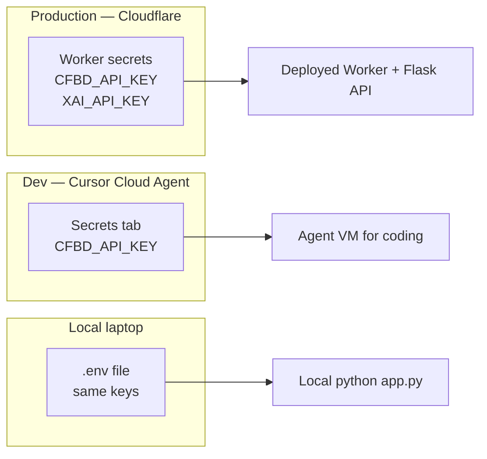

# Secrets architecture

Three places, three jobs. **Production secrets live in Cloudflare.**



## Source of truth by environment

| Environment | Where secrets live | What for |
|-------------|-------------------|----------|
| **Production (deployed app)** | **Cloudflare** — Container/Worker secrets | The live API that users hit |
| **Cursor Cloud Agent** | Cursor Secrets tab | Spinning up the app *while coding* in the agent VM |
| **Your laptop** | `.env` (gitignored) | Local `python app.py` |

You are correct: once the app is deployed, Cloudflare should hold the production keys. Cursor secrets are only so the Cloud Agent can run the API during development — they are **not** a substitute for Cloudflare production secrets.

---

## Production: put secrets in Cloudflare

### API (Cloudflare Containers / Workers)

Dashboard → your API service → **Settings → Variables and Secrets** → **Add secret**:

| Secret | Required? | Purpose |
|--------|-----------|---------|
| `CFBD_API_KEY` | **Yes** | Fetch game data from CollegeFootballData.com. One key only. |
| `XAI_API_KEY` | When live xAI is enabled | provisioned by DevSecOps on Michael's yes. The Worker reads this name only to authorize the AI Gateway grok path. Do not put a value in the repo. Workers AI uses the `[ai]` binding, not a key. |
| `CACHE_CLEAR_SECRET` | Optional | Admin `POST /cache/clear`. Header `X-Cache-Secret` only. |
| `SPEND_KILL_SECRET` | DevSecOps provisions on Michael's yes (D-20261019-174) | `POST /api/spend/kill`. Header `X-Spend-Kill-Secret` only. Not forwarded to the container. Unset fails closed (403) and does not use `CACHE_CLEAR_SECRET`. |
| `CORS_ORIGINS` | Optional | Comma-separated browser origins. Unset means same-origin only. `*` is ignored. Credentials are not allowed. |
| `DROP_WEBHOOK_URL` | Optional | ESP webhook for `POST /drop/subscribe` (The Drop) |
| `PUBLIC_SITE_URL` | Optional (build, public) | Public origin, written `{SITE_URL}`. Inlined into the client. Custom domain: pending Michael's choice. Unset ships same-origin relative links and skips `sitemap.xml`. Not a secret. |
| `PUBLIC_TURNSTILE_SITE_KEY` | Optional (build, public) | Turnstile widget id. Inlined into the client and rendered only when set. Not a secret. The matching secret is `TURNSTILE_SECRET_KEY` on the Worker. Build the site key into the frontend before setting the secret, or agent calls return "Try again." |
| `TURNSTILE_SECRET_KEY` | When the widget is on | Worker secret. siteverify for `/api/agent/*`. Not forwarded to the container. Unset, production logs a warning and keeps `AI_MAX_CALLS` plus the per-IP rate limits. `TURNSTILE_REQUIRED=1` with no secret logs one JSON line (`turnstile_unconfigured`, secret `missing`) and returns that code. |

Or via CLI (after `wrangler login` once on your machine):

```bash
wrangler secret put CFBD_API_KEY
```

`XAI_API_KEY` is provisioned by DevSecOps on Michael's yes. This repo only references that name. `CFBD_API_KEY` binds into the container. `XAI_API_KEY` stays on the Worker and is not forwarded into Flask.

`CF_ACCOUNT_ID` and `AI_GATEWAY_ID` are non-secret Worker vars (`AI_GATEWAY_ID` is `true-rankings`). Live xAI calls go to `https://gateway.ai.cloudflare.com/v1/{CF_ACCOUNT_ID}/{AI_GATEWAY_ID}/grok/...`. Workers AI passes `gateway: { id }` on `env.AI.run`. The gateway logs the call and does not cache it. The `spend-budget` instance remains the budget. Release Ops creates AI Gateway `true-rankings` in the account, then sets `CF_ACCOUNT_ID`. This repo does not create the gateway.

### Frontend (Cloudflare Worker static assets)

**No API keys.** The SPA calls `/api/*` on the same origin; the Worker routes API traffic to the Flask container (`wrangler.toml` → `run_worker_first`).

Do **not** put `XAI_API_KEY` or CFBD keys in Worker `vars` visible to the client build.

---

## Dev-only: Cursor Secrets (not environment.json)

While a Cloud Agent is coding and needs to *run* the API in the VM, add the same keys in Cursor:

→ [.cursor/SECRETS.md](../.cursor/SECRETS.md)

**Important:** this repo’s Cloud Agent environment is driven by `.cursor/environment.json` (repo-file). That environment’s dashboard page often has **no Secrets UI**. Add `CFBD_API_KEY` as a **Personal or Team Runtime Secret** on the main [Cloud Agents](https://cursor.com/dashboard/cloud-agents) Secrets page — the same place `CFBD_API_KEY` already comes from. Do not put secrets in `environment.json`. `XAI_API_KEY` is provisioned by DevSecOps on Michael's yes and is not a local coding secret.

That does **not** deploy them to Cloudflare. After you deploy, set them again (once) in Cloudflare as above.

---

## Local spend guards

| Variable | Local default | Purpose |
|----------|---------------|---------|
| `CFBD_OFFLINE=1` | Yes in development | Block live CFBD HTTP; use `.cache/` + `frontend/static/rankings/` |
| `CFBD_MAX_CALLS` | **4/day** in production config; **25/day** in code if unset | Hard cap on live CFBD calls. Unset is never unlimited. |
| `AI_MODE=stub` | Yes locally and in preview / `env.dev` | Template explanations. No live provider call. |
| `AI_MODE=off` | Opt-in | `explanation: null` + structured context only |
| `AI_MODE=live` | Production `wrangler.toml` `[vars]` (Workers AI). Opt-in locally. | xAI or Workers AI, each under its own daily cap. Production keeps xAI off (`XAI_ENABLED=0`, `XAI_MAX_CALLS=0`). |
| `XAI_MAX_CALLS` / `XAI_ENABLED` | hard **0** / off | xAI stays refused, including when `XAI_API_KEY` is set. The gateway path is not called. |
| `XAI_WEEKLY_USD_CAP` | **0** | Rolling ISO-week dollar stop. CI fails at $5 a week with CFBD's paid tier. |
| `AI_MAX_CALLS` | **100/day** | Workers AI call cap. 100 × 58 worst-case Neurons = 5800, under the 8000 ceiling. |
| `AI_PROVIDER` | `workers_ai` | Live path when a request omits `provider` |
| `AGENT_RATE_LIMIT` | 50/hour in development, 30/hour in production | Per-visitor cap on `/agent/*`, keyed on `CF-Connecting-IP` only. Applies to both providers. |
| `AI_KILL` | off | `1` stops both xAI and Workers AI |
| `XAI_KILL` / `WORKERS_AI_KILL` | off | `1` stops that provider only |
| `CFBD_KILL` | off | `1` stops every live CFBD call |
| `PREVIEW_AI_MODE` / `PREVIEW_CFBD_OFFLINE` | stub / `1` on non-production hosts | Explicit override for preview and dev versions |

Free CFBD tier is **1,000 calls/month**. Prefer static 2024 weeks for UI work.
The Worker returns 404 for `/api`, `/api/agent/health`, and `/api/cache/stats`. Flask still answers `/agent/health` inside the container with `{ "status": "ok" }` only. It does not include budgets, call counts, or cache paths. The global daily counters live on the `CfbApiContainer` instance named `spend-budget`. `POST /api/cache/clear` is header `X-Cache-Secret` only. `TURNSTILE_REQUIRED=1` (set on `env.dev`, not production) refuses agent calls when `TURNSTILE_SECRET_KEY` is missing and returns `turnstile_unconfigured`.

Scheduled blurbs: `.github/workflows/precompute-blurbs.yml` runs **stub/offline only**. A live provider call happens on **Cloudflare** when `AI_MODE=live` and static/cache miss. Artifacts are uploaded; commit-to-main remains optional.

---

## What about GitHub secrets?

| Secret in GitHub | Needed? |
|------------------|---------|
| `CFBD_API_KEY` | Only if CI must hit the live CFBD API (optional for unit tests — tests mock the API) |
| `XAI_API_KEY` | **No** — provisioned by DevSecOps on Michael's yes, in Cloudflare only |
| Production Cloudflare tokens | **No** for deploy — keep those in Cloudflare |

Prefer: GitHub CI uses stubs / mocks / no live keys. Production keys only in Cloudflare.

---

## Mental model

1. **Deploy the app to Cloudflare** (Pages Git integration + Containers).
2. **Paste secrets once in the Cloudflare dashboard** for the API service.
3. Use Cursor Secrets only when you want the Cloud Agent to run the stack during development.
4. Never commit secrets; never put API keys in the frontend.
